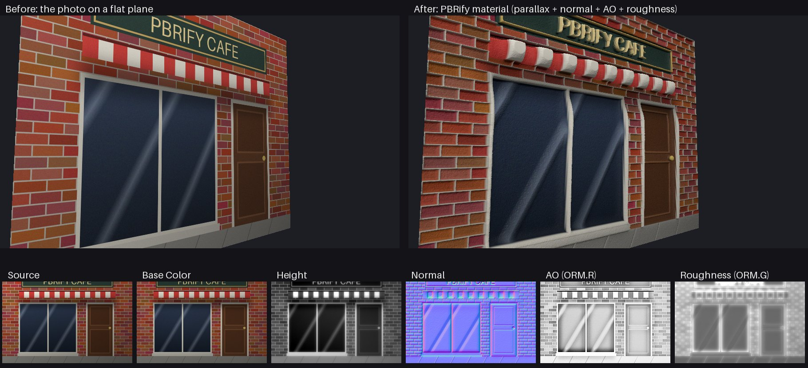

# PBRify

Turn any image into a PBR material with real-looking depth, right inside Unreal Engine.

Right-click a texture → **PBRify: Generate PBR Material**, and you get:

| Asset | What it is |
| --- | --- |
| `T_<Name>_BaseColor` | The image with large-scale baked lighting toned down |
| `T_<Name>_Normal` | Tangent-space normal map (DirectX style, what Unreal expects) |
| `T_<Name>_Height` | 16-bit height map (bright = raised, dark = recessed) |
| `T_<Name>_ORM` | Packed AO (R), roughness (G), metallic (B) |
| `MI_<Name>` | A material instance with **parallax occlusion mapping**, so windows sink in, signs pop out and bricks get chunky |



*A synthetic storefront test image, with a CPU preview of the generated material. Left: the photo on a flat plane. Right: the PBRify material.*

## Install

1. Copy (or `git clone`) this folder into your project's `Plugins/` folder, so you have `YourProject/Plugins/PBRify/PBRify.uplugin`.
2. Open your project. When Unreal says the PBRify module is missing or was built with a different version, click **Yes** to rebuild it.
   - You'll need the C++ toolchain Unreal uses (Visual Studio 2022 with the "Game development with C++" workload on Windows).
   - **Blueprint-only project?** Add any C++ class once (*Tools → New C++ Class*) to turn it into a C++ project, then reopen it.
     Or build the plugin on its own:
     `RunUAT.bat BuildPlugin -Plugin="C:/Path/PBRify/PBRify.uplugin" -Package="C:/Path/PBRifyBuilt"`
3. Check it's on under *Edit → Plugins → Editor → PBRify*.

Written for Unreal Engine 5.8, and it should also work on recent 5.x versions.

## Use

1. Drag your image (PNG, JPG, TGA…) into the Content Browser to import it.
2. Right-click it → **PBRify: Generate PBR Material**. Or pick **Generate with Options…** to tweak the settings first.
3. Drag the new `MI_<Name>` onto a mesh (a plane or cube is a good start).
4. Open the material instance and play with the sliders live:

| Parameter | Does |
| --- | --- |
| `ParallaxDepth` | How deep the surface looks. Start around 0.03–0.08 |
| `ParallaxSteps` | Quality of the depth effect. Higher = cleaner edges, more cost |
| `ReferencePlane` | Which height stays on the mesh surface (0.5: higher bits stick out, lower bits sink in) |
| `Tiling` | Repeat the texture |
| `NormalStrength`, `AOStrength`, `RoughnessScale` | Surface punch |

You can select several textures and PBRify them all at once. Re-running on the same texture updates the existing assets in place, so anything already using them keeps working.

The shared master material is created once at `/Game/PBRify/M_PBRify_Master` (you can change that path in the settings).

## Settings

Under *Edit → Editor Preferences → Plugins → PBRify*, or in the **Generate with Options…** window.

| Setting | Default | Notes |
| --- | --- | --- |
| Max Resolution | 2048 | Bigger images are downscaled first. 0 = keep the source size |
| Tileable | off | Turn on for seamless textures so the maps tile too. Leave off for photos |
| Output Subfolder | (empty) | Puts the generated assets in a subfolder next to the source |
| Create Material | on | Also make the parallax material instance |
| Delight Strength | 0.5 | Removes baked-in sun gradients and big soft shadows from the base color |
| Invert Height | off | Use this if dark things should be raised in your image |
| Fine / Medium / Large / Shape Detail | 0.2 / 0.6 / 1.0 / 1.0 | How much each size of feature contributes to the height: grain → bricks → frames → whole windows |
| Height Contrast | 1.0 | |
| Normal Strength | 1.0 | |
| AO Strength | 1.0 | |
| Roughness Base / Variation | 0.7 / 0.3 | Busy, textured areas get rougher; smooth areas (glass, paint) get glossier |
| Metallic | 0 | |
| Parallax Depth | 0.05 | Default depth on new material instances |

## Scripting

Blueprint (Editor Utility) and Python can call it too:

```python
import unreal
texture = unreal.load_asset("/Game/Photos/T_Storefront")
result = unreal.PBRifyLibrary.pbrify_texture(texture)
print(result.material, result.height)  # empty on failure; the reason is in the Output Log
```

## How it works

There's no AI here, just classic image processing (the same family of tricks as CrazyBump or Materialize):

- **Height**: the image's brightness is split into detail bands, from pixel grain up to whole windows, and recombined with your weights. The very largest scale is dropped, so leftover lighting gradients don't turn into fake slopes.
- **Normal**: the slope of the height map.
- **AO**: how far each spot sits below its surroundings, at two scales.
- **Roughness**: how "busy" the local texture is, plus extra grime in crevices.
- **Base color**: divided by a heavily blurred copy of its own brightness, to cancel out large-scale lighting.
- **Material**: a custom HLSL node marches the view ray through the height map (parallax occlusion mapping), and every texture is sampled at the shifted UVs.

It's a heuristic, so it won't always guess right about what's raised and what's recessed. Mortar between bricks is usually lighter than the bricks, for example, so it comes out raised. That's what the sliders and **Invert Height** are for.

Parallax fakes depth inside the surface, but the silhouette stays flat. For real geometry, use the 16-bit `T_<Name>_Height` with Nanite displacement / tessellation.

## Code layout

```
Source/PBRify/
  Private/Processing/PBRifyCore.*   Image -> maps. Plain C++, no Unreal dependencies
  Private/PBRifyGenerator.cpp       Reads the UTexture2D, runs the core, writes texture assets
  Private/PBRifyMaterialBuilder.cpp Builds the master material graph + material instances
  Private/PBRifyModule.cpp          Content Browser right-click menu
  Private/PBRifyOptionsDialog.cpp   "Generate with Options..." window
  Public/PBRifySettings.h           All the settings
  Public/PBRifyLibrary.h            Blueprint / Python entry point
Tests/                              Standalone tests for the core
```

The core can be built and tested without Unreal:

```sh
cmake -S Tests -B Tests/Build && cmake --build Tests/Build && ./Tests/Build/PBRifyCoreTests
```

The same executable can process an image for quick tuning (binary PPM in; base color, normal, ORM and 16-bit height out):

```sh
./Tests/Build/PBRifyCoreTests --process photo.ppm out_dir NormalStrength=2 InvertHeight=1
```
